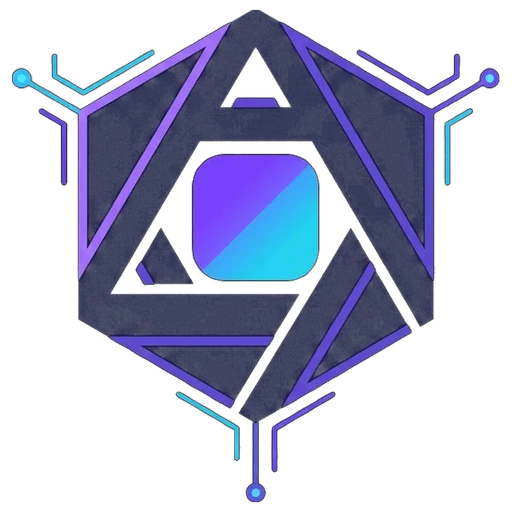
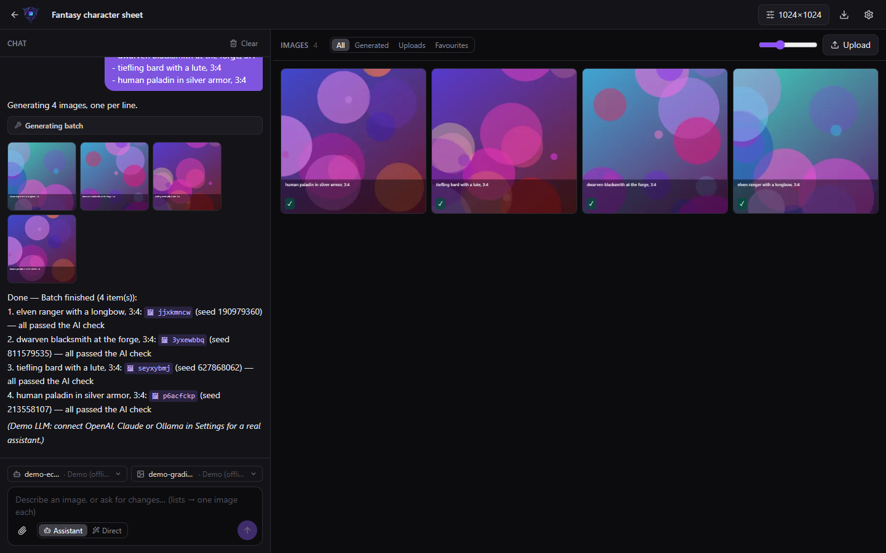
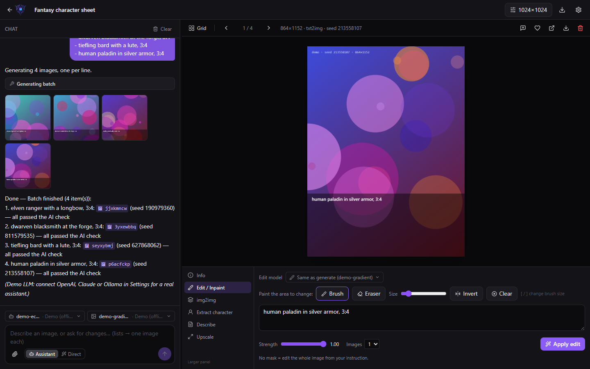
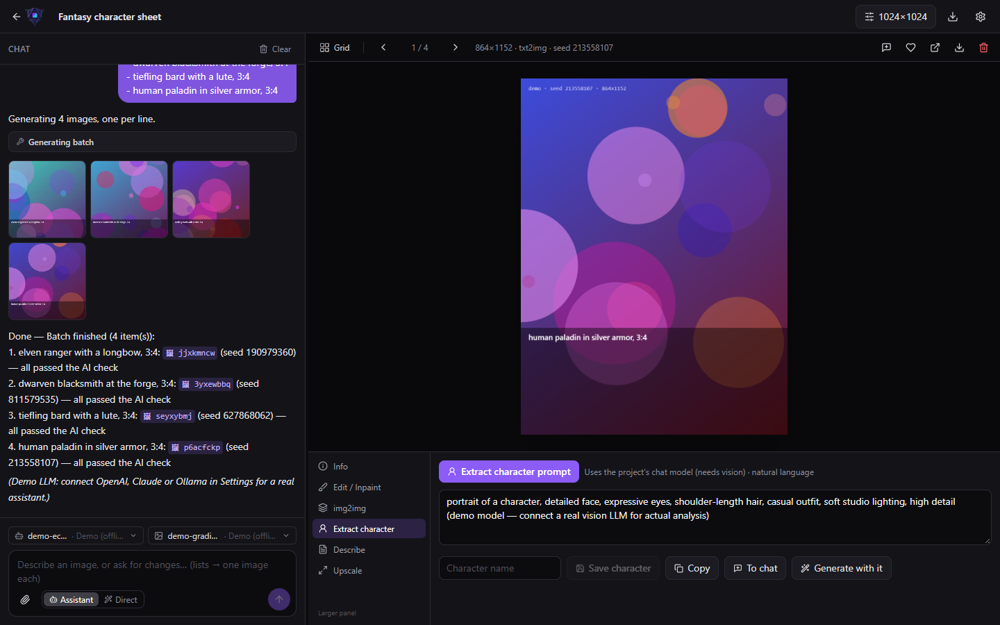
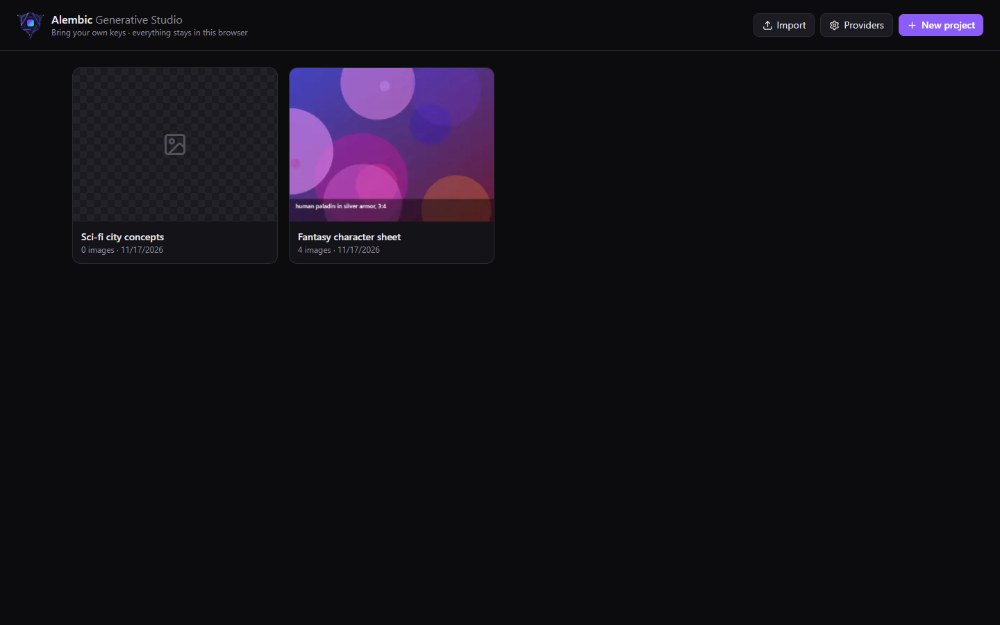
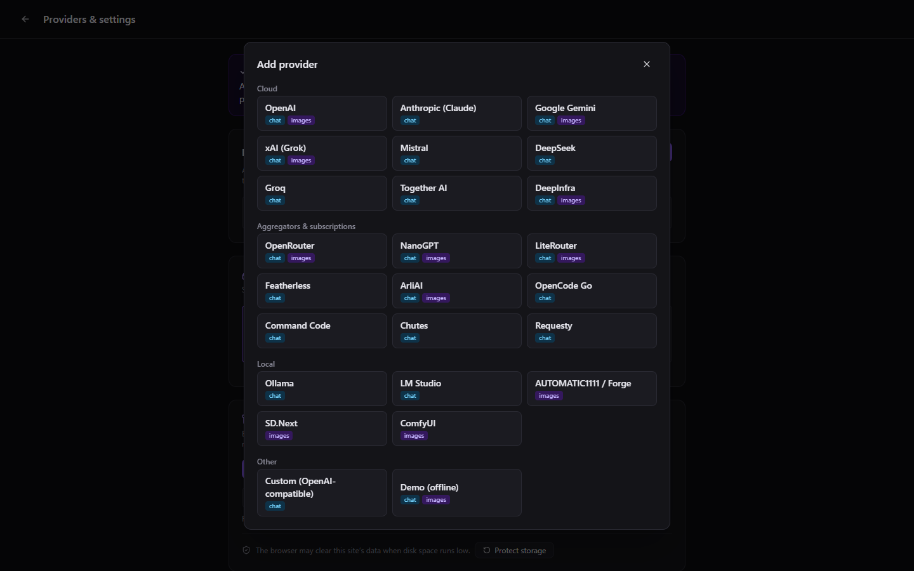
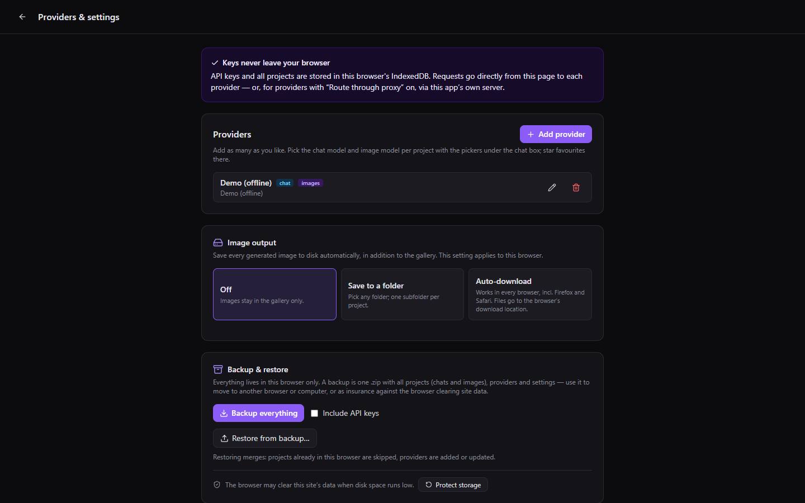

<p align="center">
  
</p>

<h1 align="center">Alembic Generative Studio</h1>

<p align="center">A bring-your-own-key, local-first studio for AI image generation.</p>

<p align="center">
  <a href="https://thatbio.vercel.app/tools/alembic/"></a>
</p>

Alembic is a web app where you chat with an LLM that writes prompts, generates images, **looks at the results** and iterates until they match what you asked for. Any image can be opened full size and reworked: inpaint, img2img, variations, extract a reusable character prompt, describe, upscale.

You bring your own API keys (OpenAI, Claude, Gemini, OpenRouter, NanoGPT, ArliAI, …) or point it at local servers (Ollama, AUTOMATIC1111 / Forge, SD.Next, ComfyUI). Everything is stored **in your browser** (IndexedDB): projects, chats, images and keys. There is no account and no database server.

## Features

- **Chat-driven generation.** The assistant turns your request into prompts, picks size and aspect ratio from your wording ("a 3:4 portrait in 2k"), and can change project defaults ("from now on use 16:9").
- **Automatic quality check.** A vision model checks every generated image against your request and regenerates only the ones that don't match, up to a retry limit you set.
- **Batches.** Send a list (one character or scene per line) and get one image per line, each checked on its own.
- **Several providers at once.** Separate model slots for chat, generate, edit and upscale, each from any provider, with search and favourites.
- **Image actions.** Mask-painting inpaint, img2img and variations, extract character, describe, upscale.
- **The assistant asks before switching models.** If the current setup can't do something, it proposes a model and waits for your Allow / Decline.
- **Saving and backup.** Optional auto-save to a folder or downloads, project export/import, and a full backup to one `.zip`.
- **Runs anywhere.** Locally with one double-click, or as a static site on Vercel, with an optional built-in CORS proxy.

## Screenshots

**Workspace:** chat on the left, gallery on the right. Here a four-line list became a batch of 3:4 portraits, each one passed the AI check (✓).



**Full view with actions:** paint a mask and describe the change (Edit / Inpaint), or turn a character into a reusable prompt (Extract character).





**Projects** are kept in the browser, with a cover image and image count.



**Providers:** presets for cloud APIs, aggregators and local servers. Add as many as you like.



**Settings:** image output to disk, backup and restore.



*The screenshots use the built-in offline demo provider, which draws placeholder images. Connect a real provider to get real images.*

## Prerequisites

- **[Node.js](https://nodejs.org/) 20 or newer**, with npm (included with Node.js). Only needed to run or build the app; visitors of a deployed site need nothing but a browser.
- **A modern browser:** Chrome, Edge, Brave, Opera, Firefox or Safari. "Save to a folder" needs Chrome, Edge or Opera (Brave after enabling a flag, see below); every other feature works in all of them.
- **At least one provider**, any of:
  - an API key for a cloud provider (OpenAI, Anthropic, Google Gemini, OpenRouter, NanoGPT, ArliAI, …), or
  - a local server: Ollama or LM Studio for chat, AUTOMATIC1111 / Forge, SD.Next or ComfyUI for images (started with its API enabled, e.g. `--api` for A1111).
- **For the assistant to see images** (AI check, extract character, describe): a chat model with vision, e.g. GPT-4o / GPT-4.1, Claude, Gemini, or a vision model in Ollama.
- **Optional:** a [Vercel](https://vercel.com/) account to host it.

Without any provider you can still try everything with the **Demo (offline)** provider that is set up on first start.

## Run locally

**Windows:** double-click **`start.bat`**. On the first run it installs dependencies, then it starts the app on http://localhost:5178 and opens your browser.

**Any OS:**

```bash
git clone https://github.com/thatBiologyStudent/alembic-generative-studio.git
cd alembic-generative-studio
npm install
npm run dev
```

Then open http://localhost:5178.

## Deploy (Vercel or any static host)

`npm run build` produces a static site in `dist/`. On Vercel, import the repo and choose the **Vite** preset. `vercel.json` already contains the SPA rewrite, and `api/proxy.ts` provides the optional CORS proxy as an Edge Function. On other static hosts everything works except the proxy.

## Providers

Add as many providers as you like under **Providers** (the gear icon). Each one has a preset that fills in the base URL, protocol and image settings, and you can change any of them. One provider can serve chat, images, or both with a single key.

| Group | Presets |
|---|---|
| Cloud | OpenAI (chat + images), Anthropic, Google Gemini (chat + Gemini image / Imagen), xAI (chat + images), Mistral, DeepSeek, Groq, Together, DeepInfra (chat + images) |
| Aggregators & subscriptions | OpenRouter (chat + images), NanoGPT (chat + images), LiteRouter (chat + images), Featherless, ArliAI, OpenCode Go, Command Code, Chutes, Requesty |
| Local | Ollama, LM Studio, AUTOMATIC1111 / Forge, SD.Next, ComfyUI |
| Other | Custom OpenAI-compatible, Google Flow (via the Flow Sidecar extension), Demo (offline) |

**Picking models.** Each project has four model slots, and every slot lists the models of all your providers, with search, favourites (star) and "Add model by name…":

| Slot | Where | Used for | When empty |
|---|---|---|---|
| Chat | under the chat box | the assistant | — |
| Generate | under the chat box | text-to-image | — |
| Edit | viewer → Edit / img2img tab | img2img, inpaint, variations, the assistant's `edit_image` | uses the Generate model |
| Upscale | viewer → Upscale tab | upscaling, the assistant's `upscale_image` | uses the Generate backend's built-in upscaler (A1111, SD.Next, ComfyUI, ArliAI) |

The slots can use different providers. For example, chat on Claude, generate with FLUX on OpenRouter, edit with a NanoGPT edit model, and upscale with NanoGPT's Topaz. When a provider reports model capabilities, which NanoGPT and OpenRouter do, each slot shows only matching models. Tick **all** to see everything.

**Size settings.** Pick an aspect ratio and a resolution tier, **1k / 2k / 3k / 4k** (≈ 1, 4, 9 and 16 megapixels), in the generation settings. The exact pixel size is calculated for you and shown next to the buttons.

**Sizes from chat.** The assistant can set the size for one request. "Make a 3:4 portrait in 2k" passes `aspect_ratio: "3:4"` and `resolution: "2k"`. 1k ≈ 1 MP, 2k ≈ 4 MP, 3k ≈ 9 MP, 4k ≈ 16 MP, and the ratio is kept exact (3:4 at 1k = 864×1152). "From now on use 16:9" calls `update_settings`, which changes the project defaults. The size each backend receives:
- **A1111, SD.Next, ComfyUI:** exact pixels.
- **OpenAI:** its fixed sizes.
- **Gemini and OpenRouter:** an aspect ratio plus a 1K/2K/4K tier.
- **NanoGPT:** the closest size the chosen model declares (`WxH`, `W*H`, `1k`/`2k` tiers, or named presets).

The tool result tells the assistant which size was actually produced.

**Automatic check and retries** (generation settings → "AI checks every generated image"; on by default). After each generation, the chat model looks at every image and judges it against your request. Images that don't match are regenerated, only the failed ones, using the checker's improved prompt. This repeats until they pass or the **max retries** limit is reached. You can set the limit from 0 to 5, and 0 means check only. Each check is one vision call and each retry is a new generation, so keep the limit low on pay-as-you-go plans. Gallery tiles show ✓ for images that passed and "✗ failed check" for ones that didn't, with the reason on hover and in the Info tab. The check needs a chat model with vision. Without one, it is skipped and the images pass.

**Batches.** In chat, give a list (one character or scene per line, or "make one image for each of …"). The assistant uses `generate_batch` and produces each item one after another, each checked on its own. Progress shows in the chat as items finish. In **Direct** mode, tick **Batch**: every line of your message becomes its own prompt. Bullet and number prefixes are stripped.

**Several images from one prompt.** The "Images" setting, or `count` in chat, is sent in as few requests as each provider allows:
- **A1111 / SD.Next:** up to 8 per request (`batch_size`).
- **ArliAI:** up to 4 per request. If ArliAI refuses a batch, for example because it's over your megapixel allowance, it falls back to one image per request.
- **NanoGPT:** up to each model's declared `max_images`.
- **OpenAI:** up to 10 per request (dall-e-3: 1).
- **OpenRouter:** `n`, topped up with extra requests if the model returns fewer.
- **Imagen:** up to 4 per request.
- **Gemini image models:** one per request.

**Model-specific settings (NanoGPT).** Seed, negative prompt, steps, CFG and strength are only sent to models whose catalogue entry lists them. Most NanoGPT models list none, and models like Chroma reject unknown settings. If no Edit model is set and the Generate model can only work from text, editing is disabled with a hint instead of sending the image to a model that can't use it.

**The assistant can propose a model, and you approve it.** When the current setup can't do something, e.g. editing while your Generate model is text-only, or no upscaler is set, or when you ask for a different or cheaper model, the assistant takes two steps. First it calls `list_models`: edit/generate/upscale-capable models from all your providers, favourites first, with NanoGPT prices. Then `request_model_change`. An **Allow / Decline** card appears in the chat and the assistant waits. Only **Allow** switches the model, so it never changes models on its own. After approval it continues with your request.

**ArliAI** uses separate API keys for text and images. Its preset has two key fields and uses the SD.Next API. Any other provider can also take a separate image key (\"Image API key (only if different)\").

**NanoGPT upscalers** (Topaz, Clarity, SeedVR2, VOSR2, P-Image, Upscaler) get the size control each model declares: `upscale_factor` for Topaz, a factor such as `"2"` for Pruna, or a `2k`/`4k`/`8k` target for SeedVR2/VOSR2.

**How image models are found:**
- OpenAI keeps only `gpt-image` / `dall-e` models from `/models`
- OpenRouter uses `/images/models`, which lists every image model it has (FLUX, Seedream, GPT image, Gemini image, …)
- NanoGPT uses its own `/image-models` catalogue
- LiteRouter, DeepInfra and other mixed lists are filtered by their metadata (`output_modalities`, `modality`, `type`), with a fallback to known image-model names (flux, sdxl, imagen, …)
- Gemini keeps the `*-image` and `imagen-*` models from the native models list
- A1111, SD.Next and ComfyUI list their installed checkpoints

| Image protocol | txt2img | img2img | inpaint | upscale | interrogate |
|---|---|---|---|---|---|
| OpenAI Images API (OpenAI, NanoGPT, LiteRouter, xAI, DeepInfra, …) | ✓ | ✓ | ✓ (mask) | – | – |
| OpenRouter (`/images`, falls back to image output from chat) | ✓ | ✓ | ✓* | – | – |
| Google Gemini / Imagen | ✓ | ✓ (Gemini image models) | ✓* | – | – |
| AUTOMATIC1111 / Forge, SD.Next | ✓ | ✓ | ✓ | ✓ | ✓ |
| ComfyUI | ✓ | ✓ | ✓ | ✓ | – |
| Google Flow (Flow Sidecar extension) | ✓ | ✓ (reference image) | – | – | – |

\* These providers have no real mask input, so the mask is sent as a second image with an instruction to change only the white area. How closely the model follows it depends on the model.

### Google Flow (Flow Sidecar extension)

Alembic can generate and edit images in **Google Flow** through the [Flow Sidecar Orchestrator](https://github.com/thatBiologyStudent/flow-sidecar-orchestrator) browser extension. Generations run in your open Flow project and use your **Flow credits**.

1. Install Flow Sidecar **1.2.3 or newer** (Chrome/Edge → Extensions → Developer mode → Load unpacked → the `flow-sidecar-extension` folder).
2. Open [Google Flow](https://flow.google.com), sign in and open a project. Best: drag that tab into its **own window** and leave it visible, so the browser doesn't slow it down.
3. In the Flow Sidecar side panel, tick **"Allow Alembic to control Flow"** (off by default).
4. In Alembic → Providers → Add provider → **Google Flow (Flow Sidecar extension)** → Save. The status line in the dialog should show ✓ Connected.
5. Pick one of its models (Nano Banana 2.1, Nano Banana Pro, Nano Banana 2 Lite) as the Generate and/or Edit model and chat as usual. A dot next to the model shows whether Flow is ready (green), needs a step (amber) or can't be reached (red); hover it for the fix.

What it supports: text-to-image and edits (the source image is sent to Flow as a reference; no masks), aspect ratios 16:9, 4:3, 1:1, 3:4 and 9:16 (others map to the nearest), up to 4 images per request (more are split into several requests), output about 1K. A generation takes roughly 20–120 seconds and only one runs at a time; if Flow is busy, Alembic waits and retries.

The extension only connects on `http://localhost:5178`, `http://127.0.0.1:5178` and `https://thatbio.vercel.app`. For another address, add it to `content_scripts[1].matches` in the extension's `manifest.json` and reload the extension. If the extension is updated or reloaded, refresh the Alembic page.

### Proxy (CORS workaround)

Many providers don't accept requests made directly from a web page. For those, turn on **Route through proxy** in the provider's settings. Requests then go through this app's own small pass-through server, which forwards them and stores nothing:

- **Running locally (`start.bat`):** the local Vite server handles `/api/proxy`. It can also reach local servers, so with the proxy on, Ollama, A1111 and ComfyUI work **without** any CORS flags.
- **On Vercel:** `api/proxy.ts` is an Edge Function that does the same, but it refuses private/local addresses.

Your API key passes through the proxy server you run, either your machine or your own Vercel deployment. New providers that aren't known to allow browser requests start with the proxy turned on.

### CORS flags (only needed without the proxy)

Browsers block cross-origin requests unless the server allows them. Replace the origin below with your own (`http://localhost:5178` locally, or your Vercel URL):

- **Ollama:** set the environment variable `OLLAMA_ORIGINS=http://localhost:5178`, then restart Ollama
- **A1111 / Forge:** `--api --cors-allow-origins=http://localhost:5178`
- **SD.Next:** `--cors-origins=http://localhost:5178`
- **ComfyUI:** `--enable-cors-header http://localhost:5178`

When the app is hosted on https (Vercel), you can still reach `http://localhost` servers. Chrome may ask for permission to access the local network. LAN addresses like `http://192.168.x.x` are blocked as mixed content, so use localhost or put the server behind https.

### ComfyUI workflows

ComfyUI ships with built-in workflows (checkpoint → KSampler) for txt2img, img2img, inpaint and upscale. You can replace any of them in the connection's advanced settings with your own **API-format** workflow (export it with "Save (API format)"). Put placeholders in string values, for example `"seed": "{{seed}}"`. The available placeholders are `prompt negative seed width height steps cfg sampler scheduler model count denoise image mask scale`.

## How it works

- `src/providers/llm/*` contains thin `fetch` adapters with streaming, vision and tool calling
- `src/providers/image/*` contains one adapter per image backend behind a shared `ImageBackend` interface, with capability flags that turn UI actions on or off
- `src/agent/runAgent.ts` runs the tool loop. The LLM can call `generate_image`, `edit_image`, `upscale_image` and `view_image`, and the generated images are sent back to it so it can see them
- `src/db/*` holds the Dexie (IndexedDB) schema, plus project export and import as `.zip`

## Where data lives, backups and image output

Everything (projects, chats, images, providers, keys) is stored in the browser's IndexedDB for this site's address only. It survives closing the browser, but **not** these:
- another browser, device or profile
- private windows
- clearing site data
- a different URL (`localhost` and the deployed site are separate, and so are Vercel preview URLs)

Safari also deletes site data after 7 days without a visit. When you create a project or save a provider, the app asks the browser to protect its storage from being cleared when disk space runs low. Settings shows whether that was granted.

**Backup & restore** (Settings): **Backup everything** saves all projects (chats + images), providers and settings in one `.zip`. API keys are left out unless you tick "Include API keys". **Restore** merges a backup into the current browser: existing projects are skipped, and providers are added or updated. Single projects can still be exported from the project menu and imported on the project list, and that Import button also accepts full backups.

**Image output** (Settings) saves every generated image to disk automatically:
- **Save to a folder:** Chrome, Edge and Opera. Brave has it switched off by default: enable it at `brave://flags/#file-system-access-api`, then relaunch. Pick any folder, and images go into one subfolder per project. After a browser restart, the browser asks once to allow access again: a small "Allow" bar appears, and images generated meanwhile wait and are written after you click it.
- **Auto-download:** every browser, including Firefox and Safari. Each image is downloaded to the browser's download location, so point that at your output folder. Browsers can't create subfolders for downloads, so files are prefixed with the project name instead.

Options:
- only save images that passed the AI check
- write a `.json` with prompt/settings next to each image
- include uploads

File names look like `2026-11-17_151237_txt2img_a-blue-owl_jvihcqe2.png`.
